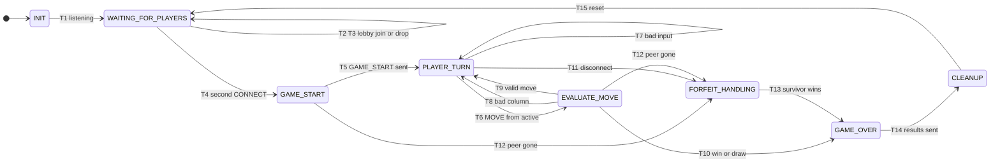

# Game State Machine (FSM) Specification - Connect Four Server

- **Student:** Edgar Flores
- **Course:** CS 457
- **Sprint:** 1
- **Companion document:** `protocol_blueprint.md` (message formats, error codes, framing)

This FSM governs the **server-side game engine** for one Connect Four match between two TCP clients. Every received frame and every socket event is processed as an _event_ that is legal in some states and illegal in others. Nothing happens outside this machine.

<!--
VS Code note: the built-in Markdown preview does not draw Mermaid diagrams.
Install the extension "Markdown Preview Mermaid Support" (bierner.markdown-mermaid),
then open the preview with Ctrl+Shift+V (Cmd+Shift+V on macOS). GitHub renders Mermaid natively.
-->

## Contents

- [1. State Transition Diagram](#1-state-transition-diagram)
- [2. State Definitions](#2-state-definitions)
- [3. Transition Table](#3-transition-table)
- [4. Message Legality Matrix](#4-message-legality-matrix)
- [5. Move Handling Logic](#5-move-handling-logic)
- [6. Disconnect Handling (Orderly and Abrupt)](#6-disconnect-handling-orderly-and-abrupt)
- [7. Implementation Skeleton (Dispatch Contract)](#7-implementation-skeleton-dispatch-contract)
- [8. Test Scenarios Derived From This FSM (for later sprints)](#8-test-scenarios-derived-from-this-fsm-for-later-sprints)

---

## 1. State Transition Diagram



_Finite State Machine (FSM) State Transition Diagram for the Connect Four Game Engine._

This design starts from the instructor's reference engine (`INIT` -> `WAITING_FOR_PLAYERS` -> `GAME_START` -> `PLAYER_TURN` <-> `EVALUATE_MOVE` -> `GAME_OVER` -> `CLEANUP`) and **adds**: a lobby self-loop, an explicit `FORFEIT_HANDLING` state for abrupt and orderly disconnects, a `PLAYER_TURN` self-loop for out-of-turn and malformed input, and disconnect edges from every in-game state.

---

## 2. State Definitions

| State                   | Entry actions                                                                                                                                                               | Events accepted                                                   | What happens on illegal events                                                                 |
| :---------------------- | :-------------------------------------------------------------------------------------------------------------------------------------------------------------------------- | :---------------------------------------------------------------- | :--------------------------------------------------------------------------------------------- |
| **INIT**                | Create listening socket (`SO_REUSEADDR`), bind `server.flores.edu` port, `listen()`. Zero game variables.                                                                   | Internal: bind success                                            | Bind failure: log and exit (no game exists yet)                                                |
| **WAITING_FOR_PLAYERS** | Accept TCP connections; start 10 s handshake timer per new socket.                                                                                                          | `CONNECT`, `DISCONNECT`, EOF/exception on a lobby socket          | Any other message type: `ERROR WRONG_STATE` to that client                                     |
| **GAME_START**          | Assign `Player_1` (first to connect, `X`) and `Player_2` (`O`). Create empty 6x7 board. Send personalised `GAME_START` to both. Set `active = Player_1`, `move_number = 0`. | Internal only (transient state)                                   | Client I/O failure here goes to `FORFEIT_HANDLING`                                             |
| **PLAYER_TURN**         | Wait for input on **both** sockets (e.g. `select()` or one thread per client).                                                                                              | `MOVE` from active player; `DISCONNECT`/EOF/exception from either | Out-of-turn `MOVE`, bad frame content, or illegal type: non-fatal `ERROR` to sender, stay here |
| **EVALUATE_MOVE**       | (Transient, atomic) Run column checks, apply gravity, check win/draw.                                                                                                       | Internal only                                                     | n/a                                                                                            |
| **FORFEIT_HANDLING**    | Identify who left. Mark the other player as winner. Increment their score.                                                                                                  | Internal only                                                     | n/a                                                                                            |
| **GAME_OVER**           | Build `GAME_OVER` (`WIN`, `DRAW`, or `FORFEIT`). Send to each still-connected client, each send in its own `try/except`.                                                    | Internal only                                                     | n/a                                                                                            |
| **CLEANUP**             | `shutdown(SHUT_WR)` and `close()` both client sockets; clear board, players, aliases, active-turn pointer. Keep cumulative `scores`.                                        | Internal only                                                     | n/a                                                                                            |

---

## 3. Transition Table

| ID  | From                      | Event / Condition                                                                                             | Actions                                                                    | To                  |
| :-- | :------------------------ | :------------------------------------------------------------------------------------------------------------ | :------------------------------------------------------------------------- | :------------------ |
| T1  | INIT                      | Socket bound and listening                                                                                    | Log "listening"                                                            | WAITING_FOR_PLAYERS |
| T2  | WAITING_FOR_PLAYERS       | Valid `CONNECT`, lobby was empty                                                                              | Register as `Player_1`; send `LOBBY_WAIT`                                  | WAITING_FOR_PLAYERS |
| T3  | WAITING_FOR_PLAYERS       | Lobby client sends `DISCONNECT`, hits EOF/exception, sends invalid `CONNECT`, or misses the handshake timeout | Send fatal `ERROR` if applicable; close socket; free the slot              | WAITING_FOR_PLAYERS |
| T4  | WAITING_FOR_PLAYERS       | Valid `CONNECT`, one player already registered                                                                | Register as `Player_2`                                                     | GAME_START          |
| T5  | GAME_START                | Board initialised, roles assigned                                                                             | Send `GAME_START` to both                                                  | PLAYER_TURN         |
| T6  | PLAYER_TURN               | Well-formed `MOVE`, sender is active player, `player_id` matches                                              | Pass to evaluation                                                         | EVALUATE_MOVE       |
| T7  | PLAYER_TURN               | Out-of-turn `MOVE`, malformed frame content, bad schema, `player_id` mismatch, or illegal message type        | Send non-fatal `ERROR` to **sender only**; turn unchanged                  | PLAYER_TURN         |
| T8  | EVALUATE_MOVE             | `col` out of range or column full                                                                             | Send `ERROR INVALID_COLUMN` / `COLUMN_FULL` to mover; **do not** swap turn | PLAYER_TURN         |
| T9  | EVALUATE_MOVE             | Valid, no win, board not full                                                                                 | Drop disc, `move_number += 1`, swap `active`, broadcast `STATE_UPDATE`     | PLAYER_TURN         |
| T10 | EVALUATE_MOVE             | Valid and creates 4-in-a-row, or board now full                                                               | Drop disc; record `WIN` (with `winning_cells`) or `DRAW`; update scores    | GAME_OVER           |
| T11 | PLAYER_TURN               | `DISCONNECT` frame, EOF, `ConnectionResetError`, `BrokenPipeError`, or timeout on either socket               | Record who left                                                            | FORFEIT_HANDLING    |
| T12 | GAME_START, EVALUATE_MOVE | Send to a client fails (peer gone)                                                                            | Record who left                                                            | FORFEIT_HANDLING    |
| T13 | FORFEIT_HANDLING          | Departed player identified                                                                                    | Survivor = winner; `result:"FORFEIT"`                                      | GAME_OVER           |
| T14 | GAME_OVER                 | `GAME_OVER` sent (or recipient already gone)                                                                  | Close sockets                                                              | CLEANUP             |
| T15 | CLEANUP                   | Resources released                                                                                            | Reset state for next match                                                 | WAITING_FOR_PLAYERS |

---

## 4. Message Legality Matrix

Which client messages are accepted in which state. `OK` = processed normally. Anything else yields the stated non-fatal `ERROR` (and the state does not change) unless noted.

| Client sends                                                                        | WAITING_FOR_PLAYERS                   | PLAYER_TURN (active player) | PLAYER_TURN (non-active player) | GAME_OVER / CLEANUP       |
| :---------------------------------------------------------------------------------- | :------------------------------------ | :-------------------------- | :------------------------------ | :------------------------ |
| `CONNECT`                                                                           | OK (T2/T4)                            | `WRONG_STATE`               | `WRONG_STATE`                   | Ignored (sockets closing) |
| `MOVE`                                                                              | `WRONG_STATE`                         | OK (T6)                     | `OUT_OF_TURN`                   | Ignored                   |
| `DISCONNECT`                                                                        | OK (T3, lobby removal)                | OK (T11, forfeit)           | OK (T11, forfeit)               | Ignored                   |
| Server-only type (`STATE_UPDATE`, `GAME_OVER`, `ERROR`, `LOBBY_WAIT`, `GAME_START`) | `UNKNOWN_MSG_TYPE`                    | `UNKNOWN_MSG_TYPE`          | `UNKNOWN_MSG_TYPE`              | Ignored                   |
| Unrecognised `msg_type`                                                             | `UNKNOWN_MSG_TYPE`                    | `UNKNOWN_MSG_TYPE`          | `UNKNOWN_MSG_TYPE`              | Ignored                   |
| Invalid JSON / schema                                                               | `MALFORMED_JSON` / `SCHEMA_VIOLATION` | same                        | same                            | Ignored                   |

A third client connecting during an active game is accepted at the TCP level by the listener, sent fatal `ERROR GAME_FULL`, and closed. It never enters the state machine.

---

## 5. Move Handling Logic

### 5.1 Validation Pipeline (ordered; first failure wins)

| Step | Check                                                           | Failure result                                                   | State effect              |
| :--- | :-------------------------------------------------------------- | :--------------------------------------------------------------- | :------------------------ |
| 1    | Frame header valid (`1 <= length <= 4096`), body fully received | Fatal `FRAME_EMPTY` / `FRAME_TOO_LARGE` / `FRAME_TIMEOUT`, close | -> FORFEIT_HANDLING (T11) |
| 2    | Body is UTF-8 JSON object                                       | `MALFORMED_JSON`                                                 | T7, stay                  |
| 3    | Envelope and payload schema valid                               | `SCHEMA_VIOLATION`                                               | T7, stay                  |
| 4    | `msg_type` known and client-originated                          | `UNKNOWN_MSG_TYPE`                                               | T7, stay                  |
| 5    | `msg_type` legal in current state                               | `WRONG_STATE`                                                    | T7, stay                  |
| 6    | `player_id` equals id assigned to this socket                   | `ID_MISMATCH`                                                    | T7, stay                  |
| 7    | Sender is the active player                                     | `OUT_OF_TURN`                                                    | T7, stay                  |
| 8    | `0 <= col <= 6`                                                 | `INVALID_COLUMN`                                                 | T8, same player retries   |
| 9    | Column has an empty cell                                        | `COLUMN_FULL`                                                    | T8, same player retries   |
| 10   | Apply move, evaluate                                            | `STATE_UPDATE` or `GAME_OVER`                                    | T9 / T10                  |

Steps 1-7 are performed in `PLAYER_TURN`; steps 8-10 in `EVALUATE_MOVE`. Because the server **never** passes the turn on an error, an invalid move simply makes the same player choose again, exactly as the SOW specifies.

### 5.2 Applying a Valid Move

1. Find the lowest row `r` (scanning from row 5 up to row 0) where `board[r][col] == "."`.
2. Place the active player's symbol (`X` or `O`) at `board[r][col]`.
3. Check for a win using only the **newly placed disc** as the centre, counting contiguous same-symbol cells in each of four axes (horizontal, vertical, diagonal `\`, diagonal `/`). A total of `>= 4` along any axis is a win. Record the 4 cells for `winning_cells`.
4. If no win and `move_number == 42` (board full), the result is `DRAW`.
5. Otherwise swap `active` and broadcast `STATE_UPDATE`.

---

## 6. Disconnect Handling (Orderly and Abrupt)

| Where the disconnect is detected            | Detection signal                                | Transition            | Outcome                                               |
| :------------------------------------------ | :---------------------------------------------- | :-------------------- | :---------------------------------------------------- |
| `WAITING_FOR_PLAYERS`                       | `DISCONNECT`, EOF, or exception on lobby socket | T3                    | Player removed; lobby slot freed; no `GAME_OVER`      |
| `GAME_START`                                | `BrokenPipeError` on `GAME_START` send          | T12 -> T13            | Survivor wins by forfeit                              |
| `PLAYER_TURN`, **active** player leaves     | `DISCONNECT`, EOF, RST, or timeout              | T11 -> T13            | Survivor wins by forfeit                              |
| `PLAYER_TURN`, **non-active** player leaves | Same signals                                    | T11 -> T13            | Survivor (the active player) wins by forfeit          |
| `EVALUATE_MOVE`                             | `BrokenPipeError` while broadcasting            | T12 -> T13            | Survivor wins by forfeit                              |
| Any in-game state, **both** players gone    | Both sockets fail                               | T11/T12 -> T13 -> T14 | `GAME_OVER` cannot be delivered; skip sends; clean up |

**Orderly vs. abrupt, same machine:** A graceful `DISCONNECT` frame and a TCP RST both land on `FORFEIT_HANDLING`. The only difference is the log line (`reason=QUIT` vs. `ConnectionResetError`). Every send inside `GAME_OVER` is individually wrapped in `try/except` so that a dead survivor cannot crash the server mid-cleanup. See `protocol_blueprint.md` Section 8 for the EOF rule and exception list.

---

## 7. Implementation Skeleton (Dispatch Contract)

This is a contract for how code must be structured. It is not the final implementation.

```python
from enum import Enum, auto

class State(Enum):
    INIT = auto()
    WAITING_FOR_PLAYERS = auto()
    GAME_START = auto()
    PLAYER_TURN = auto()
    EVALUATE_MOVE = auto()
    FORFEIT_HANDLING = auto()
    GAME_OVER = auto()
    CLEANUP = auto()

# (state, event) -> handler. Anything not in this table is a bug or a WRONG_STATE.
# Events: "CONNECT", "MOVE", "DISCONNECT", "CLIENT_DISCONNECTED", "INTERNAL_*"
```

Rules for the implementation:

- Exactly one variable, `self.state`, holds the current state. It is changed **only** inside a single `transition(new_state)` method that logs `old -> new` with the transition ID.
- Each handler returns the next state; handlers never set `self.state` directly.
- All socket reads go through `read_message(sock)` (framing + validation); all writes go through `send_message(sock, msg)`. No handler calls `recv()` or `sendall()` directly.

---

## 8. Test Scenarios Derived From This FSM (for later sprints)

| #   | Scenario                                         | Expected path                                        |
| :-- | :----------------------------------------------- | :--------------------------------------------------- |
| 1   | Two clients connect, play to a horizontal win    | T1, T2, T4, T5, (T6, T9)x, T6, T10, T14, T15         |
| 2   | Board fills with no winner                       | ... T10 with `DRAW`                                  |
| 3   | Player 2 sends `MOVE` on Player 1's turn         | T7, `OUT_OF_TURN`, turn unchanged                    |
| 4   | `MOVE` with `col: 9`                             | T6, T8, `INVALID_COLUMN`, same player retries        |
| 5   | `MOVE` into a full column                        | T6, T8, `COLUMN_FULL`, same player retries           |
| 6   | Garbage bytes / invalid JSON in a valid frame    | T7, `MALFORMED_JSON`, stream stays in sync           |
| 7   | Length header `0xFFFFFFFF`                       | Fatal `FRAME_TOO_LARGE`, T11, forfeit                |
| 8   | Player 1 closes terminal (`DISCONNECT`) mid-game | T11, T13, `GAME_OVER` `FORFEIT` to Player 2          |
| 9   | Player 1 killed with `kill -9` mid-game          | RST/EOF, T11, T13, `GAME_OVER` `FORFEIT` to Player 2 |
| 10  | Player 1 disconnects while alone in lobby        | T3, lobby empty, server keeps listening              |
| 11  | Third client connects during a game              | Fatal `GAME_FULL`, game unaffected                   |
| 12  | One message sent 1 byte at a time                | Reassembled correctly, same result as a single send  |
| 13  | Three messages in a single `send()`              | All three processed in order                         |