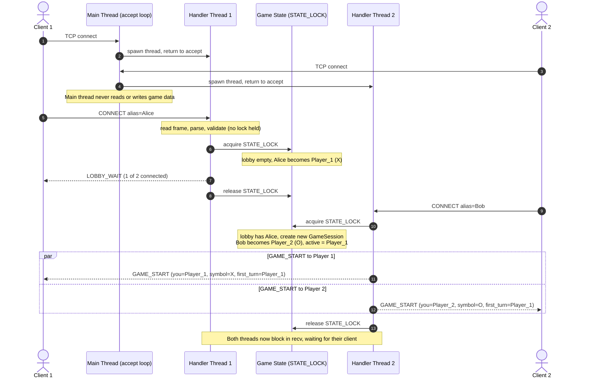
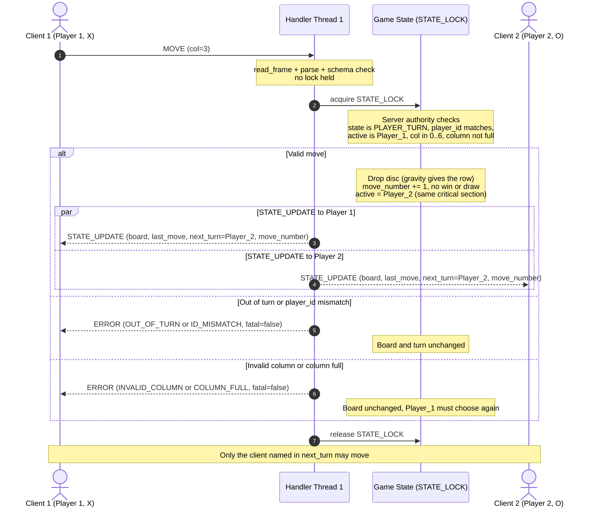
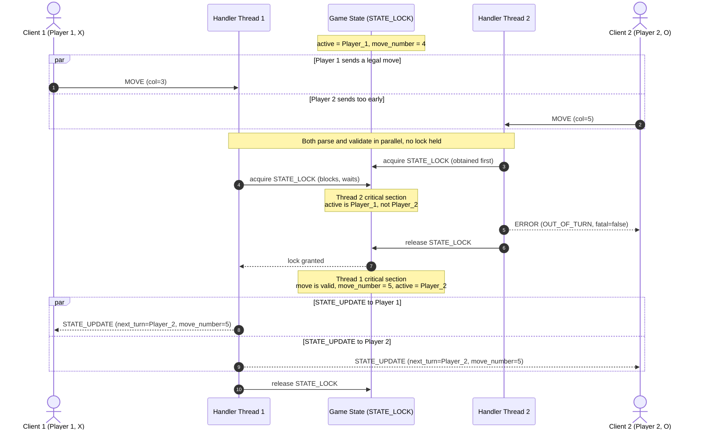
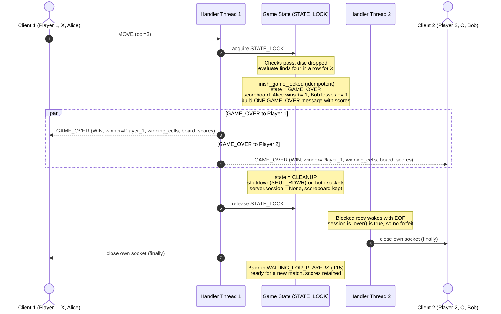
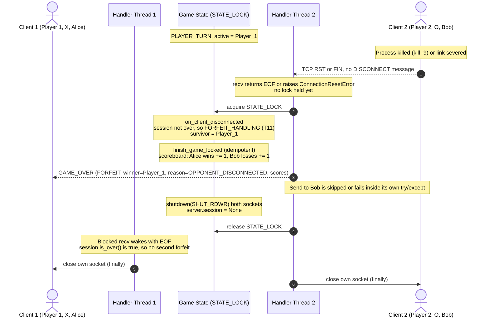

# State, Turn & Score Broadcast Sequence Diagrams - Connect Four Server

**Student:** Edgar Flores
**Course:** CS 457 - Computer Networks and the Internet
**Sprint:** 2
**Companion documents:** `concurrency_design.md` (lock rules, race analysts), `protocol_blueprint.md` (messages), `fsm_specification.md` (states)

All diagrams use Mermaid `sequenceDiagram` syntax and render natively on GitHub.

**How to read them:** `Client 1` and `Client 2` are the two players. `Handler Thread 1/2` are the per-connection server threads from `concurrency_design.md`. `Game State` stands for the shared data guarded by `STATE_LOCK` (board, active player, scoreboard). A message arrow from a handler thread to a client is a write on that client's socket, always performed while holding `STATE_LOCK`.

**Difference from the assignment's example diagram:** the example shows `MOVE (row: 0, col: 2)`. This project's protocol (Sprint 1) sends only `col`, because gravity determines the row and the server computes it. The diagrams below use the real protocol messages.

## Contents

- [1. Connection Setup and Matchmaking (Two Simultaneous Clients)](#1-connection-setup-and-matchmaking-two-simultaneous-clients)
- [2. Move, Server Validation, and State Broadcast](#2-move-server-validation-and-state-broadcast)
- [3. Simultaneous Requests: Out-of-Turn Move Racing a Valid Move](#3-simultaneous-requests-out-of-turn-move-racing-a-valid-move)
- [4. Game-Ending Move, Score Update, and Score Broadcast](#4-game-ending-move-score-update-and-score-broadcast)
- [5. Abrupt Disconnect and Forfeit](#5-abrupt-disconnect-and-forfeit)
- [6. Traceability to the Sprint 2 Acceptance Criteria](#6-traceability-to-the-sprint-2-acceptance-criteria)

## 1. Connection Setup and Matchmaking (Two Simultaneous Clients)

This shows that the main thread never blocks on a client and that the lock decides who becomes Player 1 and who becomes Player 2.

**Narrative**

1. The main thread accepts each TCP connection and immediately hands it to a new handler thread, so it is always free to accept the next one.
2. Each handler thread reads and validates `CONNECT` on its own, without any lock (FSM steps 1-4).
3. Registration happens under `STATE_LOCK`. Whichever thread takes the lock first with an empty lobby becomes `Player_1` (race R3 in `concurrency_design.md`).
4. The second `CONNECT` creates a fresh `GameSession`, assigns roles, and sends a personalised `GAME_START` to both clients (FSM T4, T5). Player 2's thread performs both sends, so Player 1's thread does not need to be woken.

## 2. Move, Server Validation, and State Broadcast

This is the core turn-synchronization flow, matching the assignment's example but with the real lock and protocol details. It covers a valid move and both rejection paths.

**Narrative**

1. Parsing and schema validation use no shared state, so they run before the lock is taken. This keeps the critical section short.
2. Inside the lock, the checks run in the Sprint 1 order: state, `player_id`, turn, column range, column full. The first failure produces a non-fatal `ERROR` to the sender only, and **the turn is not passed**.
3. A valid move is applied, `move_number` is incremented, and `active` flips, all in one critical section (invariants I2 and I3).
4. The `STATE_UPDATE` is built once and serialized once, so both clients receive byte-identical frames. Both writes complete before the lock is released, so no other thread can emit another message to either client in between. `par` is used to show the two sends are one atomic step from the game's point of view; on the wire they are two consecutive `sendall()` calls in a fixed order (Player 1, then Player 2).

## 3. Simultaneous Requests: Out-of-Turn Move Racing a Valid Move

This shows two handler threads contending for the lock at the same instant. It is the scenario that proves out-of-turn moves cannot corrupt state.

**Narrative**

1. Both messages arrive at nearly the same time and are parsed in parallel because parsing needs no lock.
2. `STATE_LOCK` admits one thread at a time. Here Thread 2 wins the lock, finds it is not Player 2's turn, replies `OUT_OF_TURN`, and changes nothing.
3. Thread 1 then runs its full check-then-act and the game proceeds normally.
4. If Thread 1 had won the lock instead, its move would apply first. Player 2's message would then be evaluated against the **new** state, where it is Player 2's turn, and would be accepted as a legitimate move. Both outcomes are valid serial orderings (serializability principle), and neither can corrupt the board. **Server state, not network arrival order, defines whose turn it is.**

## 4. Game-Ending Move, Score Update, and Score Broadcast

This shows how round scores are stored and pushed to both clients on completion (assignment section 2.3).

**Narrative**

1. The winning move is detected inside the same critical section that applied it. The thread that placed the winning disc runs `finish_game_locked()`.
2. Scores are updated **exactly once** in server memory (`wins`, `losses`, `draws` per alias), because `finish_game_locked()` returns immediately if the session is already over.
3. A single `GAME_OVER` message is built from the committed scoreboard (`scores = {"Player_1": wins, "Player_2": wins}`) and sent identically to both clients. This is the score-table broadcast. No scores are sent in `STATE_UPDATE` because they cannot change mid-game.
4. The finishing thread calls `shutdown(SHUT_RDWR)` on both sockets after writing `GAME_OVER`. This wakes the other thread's blocking `recv()` so it can exit; it sees `session.is_over()` and ends quietly instead of treating the EOF as a forfeit.
5. The server returns to `WAITING_FOR_PLAYERS` with the scoreboard intact (FSM T14, T15).

## 5. Abrupt Disconnect and Forfeit

This shows connection loss being detected by one thread and resolved safely while the other thread is blocked waiting.

**Narrative**

1. A crash produces no `DISCONNECT` frame. The server learns of it only from EOF (`b""`) or a socket exception in the dead player's own thread (`protocol_blueprint.md` Section 8). A graceful `DISCONNECT` frame follows the same path from the lock onward.
2. The thread that detects the loss takes `STATE_LOCK`, so it cannot interleave with a move being processed by the other thread (race R5).
3. `finish_game_locked()` records the forfeit, sends `GAME_OVER` (`FORFEIT`) to the survivor inside its own `try/except` (the survivor may also be gone), and shuts down both sockets.
4. If both players drop at once, whichever thread gets the lock first finishes the game and the other finds the session already over, so there is no double `GAME_OVER` and no double scoring (race R6).

## 6. Traceability to the Sprint 2 Acceptance Criteria

| Acceptance criterion                                                              | Where it is shown                                                                   |
| :-------------------------------------------------------------------------------- | :---------------------------------------------------------------------------------- |
| At least 2 simultaneous clients without blocking the main loop                    | Diagram 1 (accept loop spawns threads; handlers block independently)                |
| Thread safety / mutex locking documented                                          | `concurrency_design.md` Sections 4-6; lock acquire/release visible in every diagram |
| Turn enforcement prevents out-of-turn corruption                                  | Diagrams 2 and 3; invariants I1-I5 in `concurrency_design.md` Section 7.3           |
| Diagram shows move requests, server validation, and simultaneous state broadcasts | Diagrams 2, 3, and 4 (`par` blocks for both clients)                                |
| Both clients receive state updates synchronously                                  | Diagrams 2 and 4; guarantee analysis in `concurrency_design.md` Section 8.2         |
| Score storage and broadcast on round completion                                   | Diagram 4 and `concurrency_design.md` Section 9                                     |
| Abrupt and orderly disconnects handled                                            | Diagram 5                                                                           |
