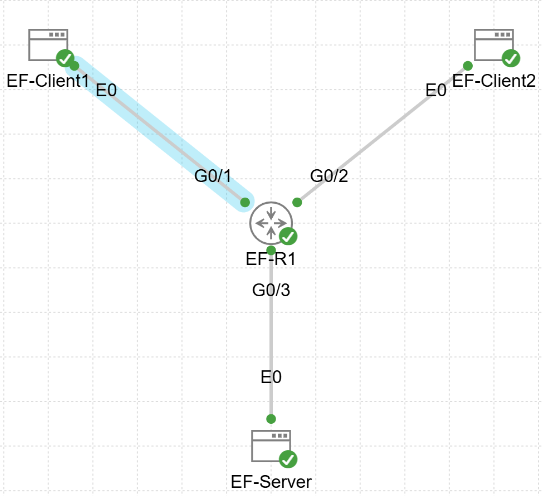
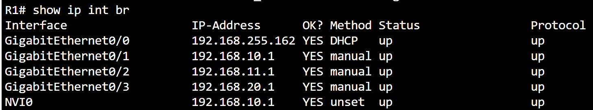
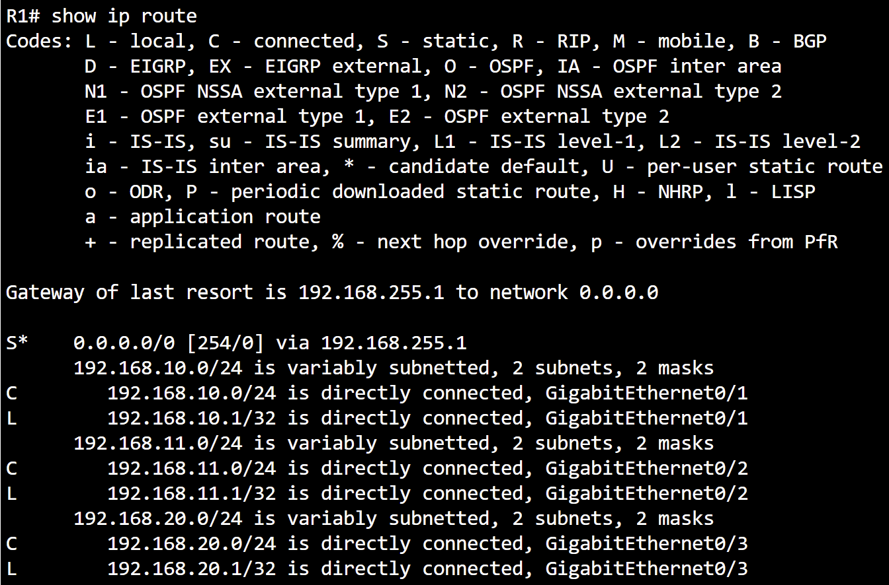
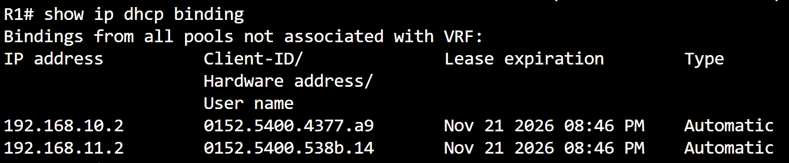
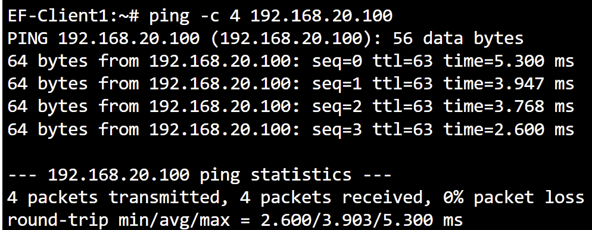
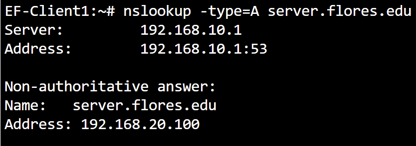
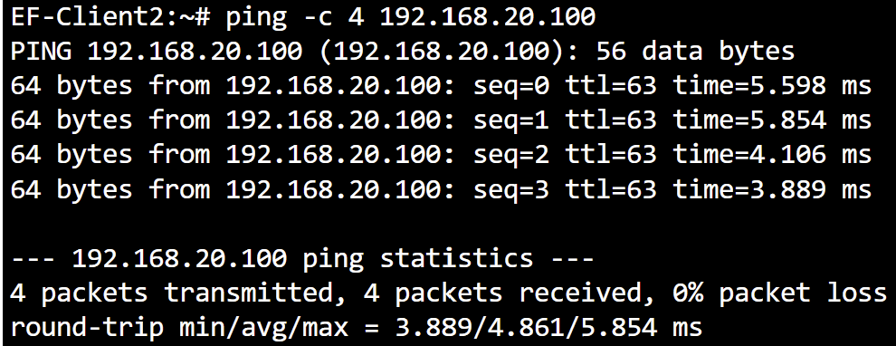
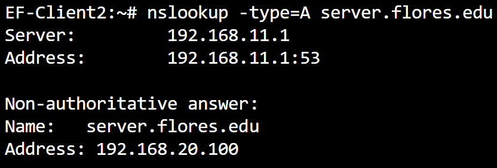
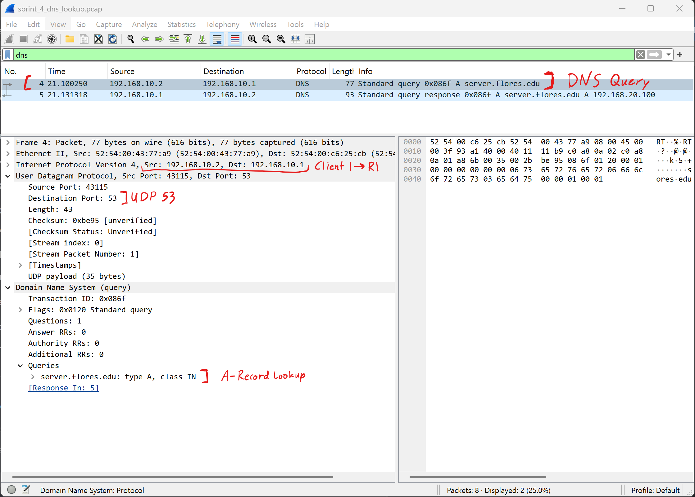
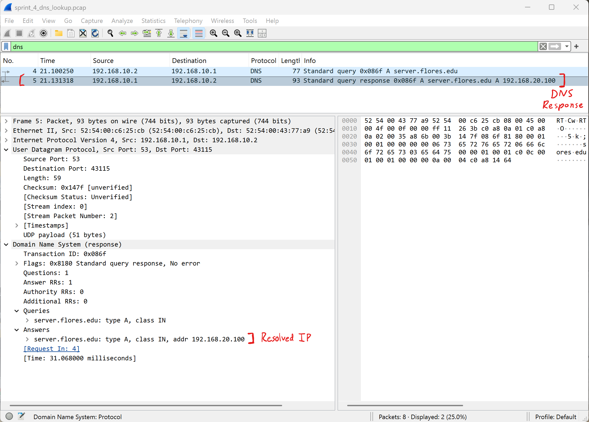

# Sprint 4 - CML 1-Router Network Topology & Connectivity Verification

**Student:** Edgar Flores

**Course:** CS 457 - Computer Networks and the Internet

**Sprint:** 4

 

*Figure 1: Screenshot showing the topology. Two Client nodes, one Server node, and one Router node. All properly named and configured.*

 
 
 

*Figure 2: Screenshot of the CLI output in the R1 router console for 'show ip int br'.*

 
 
 

*Figure 3: Screenshot of the CLI output in the R1 router console for 'show ip route'. (Note: full route not captured due to length)*

 
 
 

*Figure 4: Screenshot of the CLI output in the R1 router console for 'show ip dhcp binding'.*

 
 
 

*Figure 5: Screenshot of the client command 'ping 192.168.20.100' for Client 1. (Note: chose to ping 4 packets)*

 
 
 

*Figure 6: Screenshot of the client command 'nslookup -type=A server.flores.edu' for Client 1.*

 
 
 

*Figure 7: Screenshot of the client command 'ping 192.168.20.100' for Client 2. (Note: chose to ping 4 packets)*

 
 
 

*Figure 8: Screenshot of the client command 'nslookup -type=A server.flores.edu' for Client 2.*

 
 
 

*Figure 9: Annotated Wireshark Capture screenshot for DNS Query.*

DHCP Option 6 & Transport (Packet 4): Client 1 (192.168.10.2) sends a standard DNS A-record query for server.flores.edu over UDP port 53 directly to Router R1 (192.168.10.1), confirming that CLIENT1_POOL properly distributed R1 as the DNS server.

 
 
 

*Figure 10: Annotated Wireshark Capture screenshot for DNS Response.*

Authoritative Resolution (Packet 5): Router R1 immediately responds (No error, Transaction ID 0x086f) with the Game Server's static IPv4 address (192.168.20.100), verifying that Cisco IOS DNS services and the static host record are functioning for cross-subnet communication.
